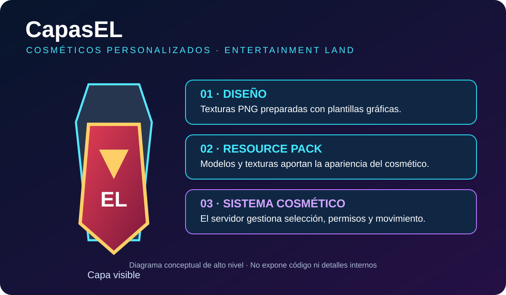

# CapasEL — escaparate público

**CapasEL** es un sistema de cosméticos para servidores Minecraft Paper que permite a los jugadores equipar capas visuales personalizadas, con animación de movimiento, permisos y recursos gráficos propios.

Este repositorio es un **escaparate informativo**. No contiene el código fuente, las clases Java, los archivos Gradle ni la configuración interna del plugin.

## Qué ofrece

- **Capas personalizadas:** diseños visuales para distinguir jugadores y rangos.
- **Movimiento dinámico:** la capa acompaña al jugador al caminar, saltar o caer.
- **Control de acceso:** permisos configurables para decidir quién puede utilizar cada diseño.
- **Integración visual:** modelos y texturas se entregan mediante un resource pack.
- **Optimización:** la versión fuente 1.4.0 documenta actualizaciones condicionales, suspensión de tareas y escucha de movimiento cuando no hay capas activas.

## Cómo funciona — explicación general

1. **Diseño:** se prepara una textura PNG a partir de una plantilla.
2. **Recurso visual:** el diseño se integra en un resource pack con sus modelos.
3. **Selección:** el jugador elige una capa disponible según sus permisos.
4. **Representación:** el servidor muestra el cosmético asociado al jugador.
5. **Movimiento:** el sistema actualiza la representación para acompañar las acciones del jugador.

> La descripción es deliberadamente de alto nivel. No se publican algoritmos, estructuras internas, código, parámetros sensibles ni detalles de implementación que permitan reconstruir el plugin.

## Plantillas de diseño

La colección de plantillas de CapasEL incluye resoluciones de 32, 64, 128 y 256 píxeles, además de una guía visual. Las plantillas son recursos para preparar texturas, no un editor gráfico completo.

## Tecnología

- Minecraft Java Edition
- Paper API 1.21.11
- Java 21
- Resource packs con modelos y texturas
- Integración opcional con PlaceholderAPI

La compatibilidad y el rendimiento deben verificarse en el entorno concreto del servidor y del cliente.

## Comandos y administración

La versión 1.4.0 documenta comandos para listar, elegir, quitar y consultar la capa propia, además de acciones administrativas para asignar, retirar y consultar capas de jugadores. También contempla permisos por capa e integración opcional con PlaceholderAPI.

## Limitaciones conocidas

- La versión documentada está dirigida a clientes Java.
- La representación descrita no ofrece compatibilidad directa con Bedrock/Geyser.
- La capa es una pieza visual rígida con movimiento simulado; no es una tela física deformable.
- El servidor no distingue entre primera y tercera persona para esta representación.

## Privacidad y propiedad del código

Este repositorio muestra el producto y explica su tecnología de forma general. **El código fuente de CapasEL se mantiene privado** y no se distribuye desde este escaparate.

---
**CapasEL · Entertainment LAND**
